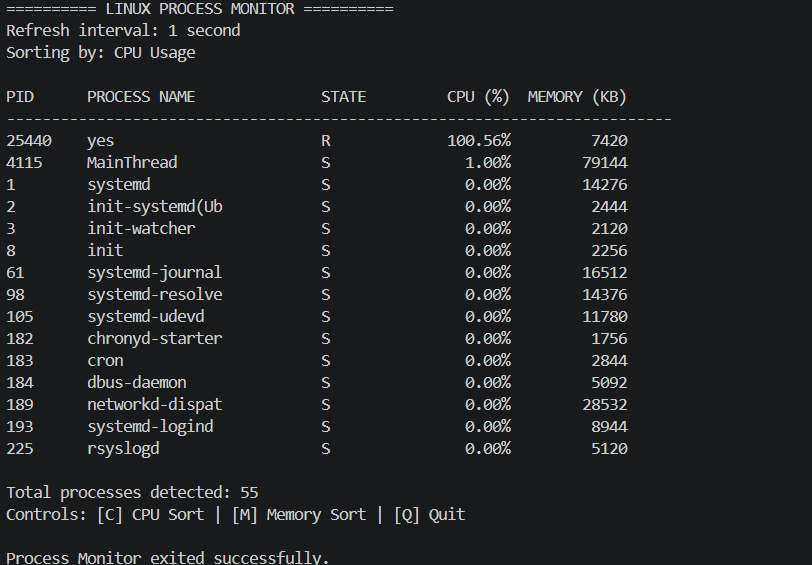
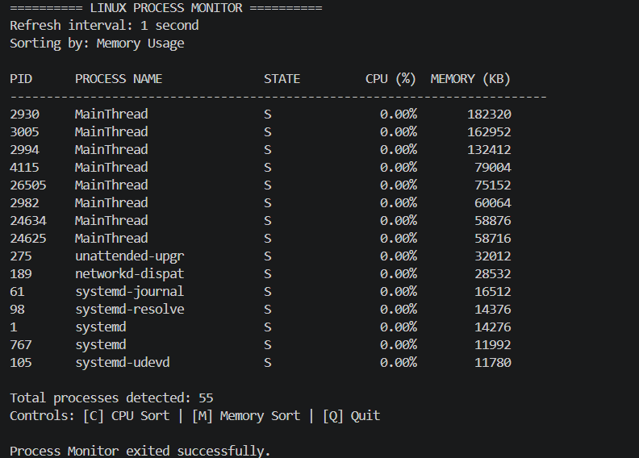

# Linux Process Monitor

A lightweight, terminal-based Linux process monitoring tool developed in **C** using the Linux `/proc` filesystem.

The application displays real-time information about running processes, including their **Process ID (PID), name, state, CPU usage, and memory consumption**. It automatically refreshes every second and allows users to sort processes interactively by CPU or memory usage.

This project demonstrates fundamental Operating Systems concepts such as process management, system monitoring, CPU scheduling statistics, memory usage, and Linux filesystem interfaces.

## Features

- **Real-Time Process Monitoring:** Displays currently running processes and updates their information every second.
- **CPU Usage Calculation:** Estimates CPU utilization by comparing process CPU time across consecutive readings.
- **Memory Monitoring:** Displays the physical memory used by each process in kilobytes (KB).
- **Interactive Sorting:** Sorts processes by CPU or memory usage in descending order.
- **Process State Tracking:** Displays process states such as Running (`R`), Sleeping (`S`), and other Linux process states.
- **Keyboard Controls:** Supports interactive sorting and quitting without pressing Enter.
- **Dynamic Memory Management:** Uses dynamic memory allocation to handle varying numbers of running processes.

## Technologies Used

| Technology | Purpose |
|---|---|
| C | Primary programming language |
| Linux / WSL2 Ubuntu | Development and execution environment |
| GCC | C compiler |
| GNU Make | Build automation |
| `/proc` filesystem | Source of process and CPU statistics |
| POSIX APIs | Terminal input and system operations |

## Project Structure

```text
process-monitor/
├── main.c          # Main loop, CPU calculations, sorting and display
├── process.c       # Reads and parses process information
├── process.h       # Process structure and function declarations
├── Makefile        # Build instructions
└── README.md       # Project documentation
```

## How It Works

### 1. Reading Process Information

The program scans the Linux `/proc` directory, where each running process has a directory identified by its PID.

For example:

```text
/proc/1234/stat
```

The program reads this file to obtain the process name, state, CPU time, and memory information.

### 2. Calculating CPU Usage

CPU usage is calculated by comparing two consecutive readings taken approximately one second apart.

The program uses:

- `/proc/[pid]/stat` to obtain CPU time consumed by individual processes.
- `/proc/stat` to obtain overall system CPU time.

The approximate CPU usage is calculated as:

```text
CPU Usage (%) =
(Process CPU Time Difference / Total CPU Time Difference)
× Number of CPU Cores × 100
```

This allows the program to estimate how much CPU time each process consumed during the measurement interval.

### 3. Monitoring Memory Usage

The program obtains Resident Set Size (RSS) information from `/proc/[pid]/stat`.

RSS represents the amount of physical memory currently occupied by a process.

The memory value is converted from pages into kilobytes.

### 4. Sorting Processes

The application uses the C standard library function `qsort()` to arrange processes in descending order based on:

- CPU utilization percentage
- Memory consumption in KB

### 5. Automatic Refresh

The monitor repeatedly reads updated process information and refreshes the terminal approximately every second.

The POSIX `termios` interface allows the program to capture keyboard input without requiring the Enter key.

## Installation and Usage

### Prerequisites

- Linux or WSL2 with Ubuntu
- GCC compiler
- GNU Make

On Ubuntu, install the required development tools:

```bash
sudo apt update
sudo apt install build-essential -y
```

### Build the Project

Navigate to the project directory:

```bash
cd process-monitor
```

Compile the source files:

```bash
make
```

### Run the Monitor

```bash
./process-monitor
```

### Clean Build Files

```bash
make clean
```

To rebuild from scratch:

```bash
make clean
make
```

## Keyboard Controls

| Key | Action |
|---|---|
| `C` | Sort by CPU usage (highest first) |
| `M` | Sort by memory usage (highest first) |
| `Q` | Quit the application |
| `Ctrl+C` | Interrupt and exit |

Lowercase keys are also supported.

## Sample Output

```text
========== LINUX PROCESS MONITOR ==========
Refresh interval: 1 second
Sorting by: CPU Usage

PID      PROCESS NAME              STATE         CPU (%)  MEMORY (KB)
--------------------------------------------------------------------------
25440    yes                       R              99.69%         7420
105      systemd-udevd             S               1.00%        11780
1        systemd                   S               0.00%        14276
61       systemd-journal           S               0.00%        16512
98       systemd-resolve           S               0.00%        14376

Total processes detected: 47
Controls: [C] CPU Sort | [M] Memory Sort | [Q] Quit
```

*The output above is an excerpt from a test run. Process IDs, memory consumption, CPU percentages, and process counts vary between systems.*

## Testing

The project was compiled using GCC with the following flags:

```bash
gcc -Wall -Wextra -Wpedantic -std=c11 -O2
```

The build completed successfully without compiler warnings or errors.

Functional testing included:

- Reading process information from `/proc`.
- Displaying CPU and memory usage.
- Refreshing process information periodically.
- Sorting processes by CPU consumption.
- Sorting processes by memory consumption.
- Exiting through keyboard controls.

A CPU-intensive `yes` process was used to verify CPU monitoring. The application successfully detected approximately 100% utilization of one CPU core and placed the process at the top when CPU sorting was enabled.

## Limitations

- Designed specifically for Linux systems with the `/proc` filesystem.
- CPU usage is estimated from periodic readings rather than measured continuously.
- Some process information may be unavailable because of permissions or because a process terminates while being read.
- Long process names are shortened in the terminal display.
- The terminal interface does not currently support scrolling or filtering.

## Future Improvements

- Add process filtering by name or PID.
- Display total system CPU and memory utilization.
- Add configurable refresh intervals.
- Support process termination through keyboard commands.
- Improve terminal rendering and navigation.

## Learning Outcomes

Through this project, the following Operating Systems concepts were explored:

- Linux process management
- Process IDs and execution states
- The `/proc` virtual filesystem
- CPU time and utilization
- Physical memory usage
- Dynamic memory allocation in C
- Sorting algorithms
- POSIX terminal handling
- Build automation using Makefiles

## Screenshots

### CPU Usage Sorting


### Memory Usage Sorting



## Author

**Ankit Sinha**
B.Tech — Computer Science and Engineering (Artificial Intelligence & Machine Learning)  
Techno Main Salt Lake, Kolkata

## License

This project was developed for educational and academic purposes.
